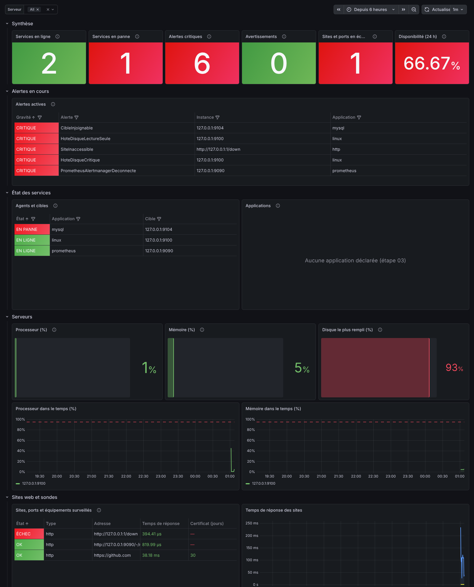

# Prometheus-bundle

Supervision applicative clé en main : **Prometheus + Alertmanager + agents par application + Grafana**,
pilotée par **un seul script autonome** (`prometheus-bundle.sh`) dont toute la configuration est en tête de fichier.



## En bref

| Étape | Commande | Rôle |
|---|---|---|
| 00 | `sudo ./prometheus-bundle.sh 00` | Vérification préliminaire (ne modifie rien) |
| 01 | `sudo ./prometheus-bundle.sh 01` | Installation de Prometheus 3.16 et Alertmanager 0.35 (+ agent Linux local) |
| 02 | `./prometheus-bundle.sh 02 afficher` | Paramètres et seuils ; `02 definir SEUIL_DISQUE_WARN 75` réécrit le script et applique |
| 03 | `sudo ./prometheus-bundle.sh 03 catalogue` | Agents et applications : installation locale, déploiement SSH, déclaration des cibles |
| 04 | `sudo ./prometheus-bundle.sh 04 ajouter` | Canaux d'alerte : Teams, Slack, Telegram, e-mail, SMS, PagerDuty, Jira... |
| 05 | `sudo ./prometheus-bundle.sh 05` | Grafana en français (sur cette machine ou une autre via `05 distant`) + vue d'ensemble + 19 tableaux par application |
| 06 | `./prometheus-bundle.sh 06 etat` | Exploitation : état, alertes, maintenance (silences), journaux |
| 07 | `sudo ./prometheus-bundle.sh 07 sauvegarder` | Sauvegarde, restauration, planification quotidienne |
| 08 | `sudo ./prometheus-bundle.sh 08 mysql` | Test des alertes d'une application : vérifie que chaque règle peut se déclencher, puis envoie une alerte simulée vers les canaux |
| 99 | `sudo ./prometheus-bundle.sh 99` | Nettoyage complet d'une installation précédente |

Sans argument, le script ouvre un menu interactif. Aide d'une étape : `./prometheus-bundle.sh 03 aide`.

## Applications supervisées (22)

| Famille | Applications |
|---|---|
| Système | Linux, Windows |
| Disponibilité | Sites et API web (code HTTP, temps de réponse, certificat TLS), ports TCP, ping |
| Bases de données | MySQL/MariaDB, PostgreSQL, Redis, MongoDB, Memcached, Elasticsearch/OpenSearch |
| Serveurs web | Nginx, Apache, PHP-FPM, HAProxy |
| Messagerie | RabbitMQ, Kafka |
| Applications | Java/JVM (Tomcat, WildFly...), Spring Boot, processus, conteneurs Docker, application instrumentée |

Chaque application apporte ses **règles d'alerte dédiées** : **132 règles** au total, en français, avec seuils réglables.
Liste complète : [docs/REGLES_ALERTE.md](docs/REGLES_ALERTE.md).

## Canaux d'alerte (14)

E-mail, Slack, Microsoft Teams, Telegram, Discord, Mattermost, Rocket.Chat, Webex, PagerDuty, Opsgenie, Pushover,
SMS (Amazon SNS), Jira, webhook générique. Plusieurs canaux en parallèle, chacun avec son filtre de gravité
(ex. Teams pour tout, SMS pour le critique).

## Grafana et tableaux de bord

- **Vue d'ensemble** : synthèse, alertes en cours, état de tous les services, serveurs, sites web.
- **19 tableaux par application**, au choix (`05 tableaux`, `05 tableau mysql redis`, ou `05 tableau auto` pour toutes les applications supervisées).
- **Tableaux communautaires** grafana.com importables par leur numéro (`05 importer 1860`) ou par fichier JSON.
- Grafana **sur une autre machine** : `05 distant admin@grafana01` depuis le serveur Prometheus ; les commandes `05` suivantes y sont relayées.

## Exemple de mise en place

```bash
sudo ./prometheus-bundle.sh 01
```

```bash
sudo ./prometheus-bundle.sh 03 deployer mysql admin@bdd01 env=prod
```

```bash
sudo ./prometheus-bundle.sh 03 cible http https://www.exemple.fr env=prod
```

```bash
sudo ./prometheus-bundle.sh 04 ajouter teams equipe-exploitation
```

```bash
sudo ./prometheus-bundle.sh 05 distant admin@grafana01
```

```bash
sudo ./prometheus-bundle.sh 08 mysql
```

## Documentation

- [Guide d'exploitation](docs/GUIDE_EXPLOITATION.md) : mise en service, ajout d'applications, alerting, Grafana local ou distant, tableaux par application, test des alertes, réaction aux alertes, maintenance, sauvegarde, mises à jour, dépannage.
- [Règles d'alerte](docs/REGLES_ALERTE.md) : les 132 règles, application par application.
- [packages/](packages/README.md) : installation hors-ligne.

## Prérequis

Linux avec systemd (Debian/Ubuntu, RHEL/Rocky/Alma), droits root, `curl` ou `wget`, accès à github.com
(ou archives dans `packages/`). L'agent Windows et cAdvisor s'installent hors du script (consignes fournies).
