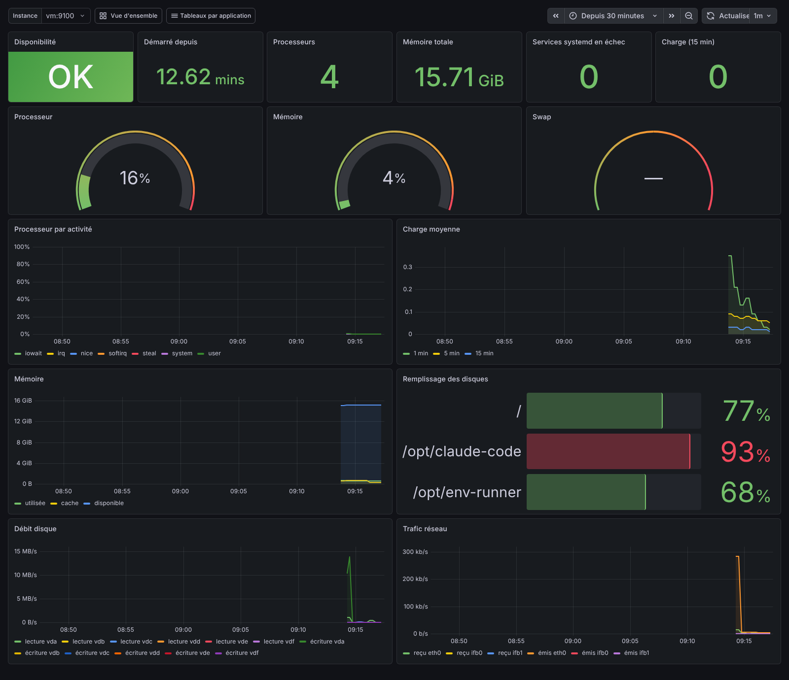

# Guide d'exploitation — Prometheus-bundle

Ce guide s'adresse aux équipes qui installent et font vivre la supervision au quotidien.
Toutes les opérations passent par un seul script : `prometheus-bundle.sh`.

---

## Sommaire

1. [Architecture](#1-architecture)
2. [Mise en service](#2-mise-en-service-premier-jour)
3. [Superviser une application](#3-superviser-une-application)
4. [Recevoir les alertes](#4-recevoir-les-alertes)
5. [Grafana](#5-grafana)
   - [Grafana sur une autre machine](#grafana-sur-une-autre-machine)
   - [Tableaux de bord par application](#tableaux-de-bord-par-application)
   - [Tableaux communautaires](#tableaux-communautaires-grafanacom)
6. [Exploitation courante](#6-exploitation-courante)
7. [Réagir à une alerte](#7-réagir-à-une-alerte)
   - [Tester les alertes d'une application (étape 08)](#tester-les-alertes-dune-application-étape-08)
8. [Maintenance programmée](#8-maintenance-programmée)
9. [Ajuster les seuils](#9-ajuster-les-seuils)
10. [Sauvegarde et restauration](#10-sauvegarde-et-restauration)
11. [Mises à jour](#11-mises-à-jour)
12. [Dépannage](#12-dépannage)
13. [Référence des fichiers et ports](#13-référence-des-fichiers-et-ports)

---

## 1. Architecture

```
  Serveurs et applications                    Serveur de supervision
  ┌──────────────────────────┐   collecte    ┌────────────────────────────┐
  │ agent (exporter) :91xx   │ ◄──────────── │ Prometheus :9090           │
  │ ex. node_exporter,       │   toutes les  │  • stocke les métriques    │
  │ mysqld_exporter...       │   30 s        │  • évalue les règles       │
  └──────────────────────────┘               └─────────────┬──────────────┘
  ┌──────────────────────────┐   sonde                     │ alertes
  │ site web / port / ping   │ ◄── blackbox_exporter :9115 ▼
  └──────────────────────────┘               ┌────────────────────────────┐
                                             │ Alertmanager :9093         │
  Grafana :3000 ── lit Prometheus ──►        │  • regroupe, déduplique    │
  (tableau de bord)                          │  • envoie vers les canaux  │──► Teams, Slack, Telegram,
                                             └────────────────────────────┘    e-mail, SMS, PagerDuty...
```

- **Agent (exporter)** : petit service installé à côté de l'application, qui traduit son état en métriques.
- **Prometheus** : interroge les agents toutes les 30 secondes et évalue les règles d'alerte.
- **Alertmanager** : reçoit les alertes, les regroupe et les envoie aux bons canaux selon leur gravité.
- **Grafana** : affiche le tableau de bord « Supervision — Vue d'ensemble ».

### Organisation du script

| Étape | Rôle | Modifie le système |
|---|---|---|
| `00` | Vérification préliminaire | non |
| `01` | Installation de Prometheus et Alertmanager | oui |
| `02` | Paramètres et seuils (afficher, définir, appliquer) | oui |
| `03` | Agents et applications | oui |
| `04` | Canaux d'alerte | oui |
| `05` | Grafana et tableaux de bord, sur cette machine ou une autre | oui |
| `06` | Exploitation : état, alertes, maintenance | non (sauf silences) |
| `07` | Sauvegarde et restauration | oui |
| `08` | Test des alertes d'une application (vérification des règles + envoi simulé) | non (envoie des alertes de test) |
| `99` | Nettoyage complet | oui |

Sans argument, le script ouvre un **menu interactif**. Chaque étape a son aide : `./prometheus-bundle.sh 03 aide`.

Toute la configuration est **dans le script** (section `CONFIGURATION` en tête de fichier). Il n'y a aucun fichier de configuration à part.
Chaque exécution qui modifie le système écrit un journal dans `/var/log/prometheus-bundle/`.

---

## 2. Mise en service (premier jour)

Prérequis : un serveur Linux avec systemd (Debian/Ubuntu ou RHEL/Rocky/Alma), 2 Go de RAM, 5 Go de disque libre au minimum
(compter environ 1 à 2 Go par mois pour 50 serveurs supervisés), un accès à github.com (ou le mode hors-ligne, voir plus bas).

```bash
sudo ./prometheus-bundle.sh 00
```

Corriger toute ligne `[ERREUR]`, puis :

```bash
sudo ./prometheus-bundle.sh 01
```

L'étape 01 installe Prometheus, Alertmanager, les 10 règles de supervision de base, **et l'agent Linux sur le serveur de supervision lui-même**
(option `--sans-agent` pour ne pas le faire). Elle se termine par un contrôle de santé des deux services.

Puis, dans l'ordre :

```bash
sudo ./prometheus-bundle.sh 04 ajouter
```

```bash
sudo ./prometheus-bundle.sh 04 tester
```

```bash
sudo ./prometheus-bundle.sh 05
```

Le mot de passe administrateur de Grafana est généré et rangé dans `/root/grafana-admin.txt`.

### Installation hors-ligne

Déposer dans le dossier `packages/` (à côté du script) les archives officielles des composants nécessaires
et les fichiers de sommes de contrôle (voir `packages/README.md`), puis :

```bash
sudo OFFLINE=yes ./prometheus-bundle.sh 01
```

---

## 3. Superviser une application

### Le catalogue

```bash
./prometheus-bundle.sh 03 catalogue
```

| Famille | Applications (`clé`) |
|---|---|
| Système | `linux`, `windows` |
| Disponibilité | `http` (site, API, certificat TLS), `tcp` (port), `icmp` (ping) |
| Base de données | `mysql` (et MariaDB), `postgresql`, `redis`, `mongodb`, `memcached`, `elasticsearch` |
| Serveur web | `nginx`, `apache`, `phpfpm`, `haproxy` |
| Messagerie | `rabbitmq`, `kafka` |
| Application | `jvm` (Tomcat, WildFly, Jetty...), `springboot`, `process`, `docker`, `application` (métriques maison) |

Chaque application vient avec **ses propres règles d'alerte**, déployées automatiquement dès la première cible déclarée.
Liste complète : [REGLES_ALERTE.md](REGLES_ALERTE.md).

### Trois façons d'ajouter une application

**a) L'agent est installé à distance par SSH (le plus simple)** — depuis le serveur de supervision :

```bash
sudo ./prometheus-bundle.sh 03 deployer mysql admin@bdd01 env=prod,equipe=finance
```

Le script se copie sur `bdd01`, y installe l'agent (en posant les questions nécessaires : utilisateur, mot de passe...),
puis déclare la cible dans Prometheus. Le compte SSH doit pouvoir utiliser `sudo`.

**b) L'agent est installé à la main sur le serveur concerné** — copier le script sur ce serveur, puis :

```bash
sudo ./prometheus-bundle.sh 03 agent mysql
```

puis sur le serveur de supervision :

```bash
sudo ./prometheus-bundle.sh 03 cible mysql bdd01 env=prod
```

**c) Sans agent** (sondes et applications qui exposent déjà leurs métriques) :

```bash
sudo ./prometheus-bundle.sh 03 cible http https://www.exemple.fr env=prod
```

```bash
sudo ./prometheus-bundle.sh 03 cible tcp smtp.exemple.fr:25
```

```bash
sudo ./prometheus-bundle.sh 03 cible springboot app01:8080 env=recette
```

Pour `windows`, `haproxy`, `rabbitmq`, `springboot`, `docker` et `application`, le script affiche la marche à suivre côté application.

### Libellés

Les libellés (`env=prod,equipe=web`) apparaissent dans les alertes et permettent de filtrer. Deux libellés sont spéciaux :
`chemin=/mon/chemin` change l'URL collectée (par défaut `/metrics`) et `schema=https` passe en HTTPS.

### Particularités par application

| Application | À préparer côté application |
|---|---|
| `mysql` | Compte de supervision : `CREATE USER 'exporter'@'localhost' IDENTIFIED BY '...' WITH MAX_USER_CONNECTIONS 3; GRANT PROCESS, REPLICATION CLIENT, SELECT ON *.* TO 'exporter'@'localhost';` |
| `postgresql` | `CREATE USER exporter WITH PASSWORD '...'; GRANT pg_monitor TO exporter;` |
| `mongodb` | Utilisateur avec les rôles `clusterMonitor` et `read` sur `local` |
| `elasticsearch` | Privilège cluster `monitor` |
| `nginx` | Page `stub_status` sur 127.0.0.1:8080 (bloc fourni par le script) |
| `apache` | `mod_status` activé, `/server-status` accessible en local |
| `phpfpm` | `pm.status_path = /status` dans le pool |
| `haproxy` | Bloc `frontend prometheus` sur le port 8405 (HAProxy 2.4 ou plus) |
| `rabbitmq` | `rabbitmq-plugins enable rabbitmq_prometheus` |
| `jvm` | Ajouter `-javaagent:/opt/jmx_exporter/jmx_prometheus_javaagent.jar=9404:/opt/jmx_exporter/config.yaml` puis redémarrer la JVM |
| `springboot` | Dépendance `micrometer-registry-prometheus`, exposer `prometheus` dans `management.endpoints.web.exposure.include` |
| `process` | Le processus doit tourner au moment de l'installation de l'agent pour être suivi |

Les mots de passe sont stockés sur le serveur de l'agent, lisibles par root uniquement
(`/etc/prometheus-exporters/<agent>/`).

### Retirer une application

```bash
sudo ./prometheus-bundle.sh 03 retirer mysql bdd01:9104
```

Quand la dernière cible d'une application est retirée, son job et ses règles sont supprimés.
Pour supprimer l'agent sur le serveur concerné : `sudo ./prometheus-bundle.sh 03 desinstaller mysql`.

---

## 4. Recevoir les alertes

### Canaux disponibles

| Canal (`type`) | Usage conseillé | Ce qu'il faut fournir |
|---|---|---|
| `teams` | Équipe sur Microsoft Teams | URL d'un workflow Power Automate « Publier dans un canal quand une requête webhook est reçue » |
| `slack` | Équipe sur Slack | URL de webhook entrant |
| `mattermost`, `rocketchat` | Messageries auto-hébergées | URL de webhook entrant |
| `telegram` | Petites équipes, mobile | Jeton du bot (@BotFather) et chat_id |
| `discord` | Communautés, petites équipes | URL de webhook du salon |
| `webex` | Équipes Cisco | Jeton du bot, identifiant de salle |
| `email` | Diffusion large, traçabilité | Serveur SMTP, expéditeur, destinataires |
| `sms` | Astreinte, alertes critiques | Numéro, clés AWS SNS |
| `pushover` | Notification push sur mobile, sonnerie | Clé utilisateur, jeton d'application |
| `pagerduty`, `opsgenie` | Astreinte avec escalade et appels | Clé d'intégration |
| `jira` | Ticket automatique par incident | URL Jira, projet, compte de service et jeton |
| `webhook` | GLPI, ServiceNow, n8n, script maison | URL (+ jeton Bearer optionnel) |

Google Chat n'est pas pris en charge nativement par Alertmanager : passer par un relais (par exemple n8n) via le canal `webhook`.

### Ajouter un canal

```bash
sudo ./prometheus-bundle.sh 04 ajouter teams equipe-exploitation
```

Le script pose les questions, puis demande quelles alertes envoyer :

1. critiques uniquement — pour un canal d'astreinte (SMS, PagerDuty...)
2. critiques et avertissements — **conseillé** pour le canal d'équipe
3. toutes, y compris les informations

Plusieurs canaux coexistent : chaque alerte part vers **tous** les canaux qui acceptent sa gravité. Exemple de dispositif classique :

| Canal | Gravités |
|---|---|
| Teams de l'équipe | critiques + avertissements |
| SMS d'astreinte | critiques |
| Jira | critiques |

Si les paramètres sont refusés par Alertmanager, **rien n'est modifié** et l'ancienne configuration reste en place.

Mode sans question (automatisation) :

```bash
sudo CANAL_WEBHOOK_URL='https://hooks.slack.com/services/...' CANAL_SALON='#alertes' CANAL_SEVERITES='critical|warning' ./prometheus-bundle.sh 04 ajouter slack equipe-web
```

### Tester

```bash
sudo ./prometheus-bundle.sh 04 tester
```

Une alerte « TestPrometheusBundle » arrive en moins de 30 secondes sur les canaux qui acceptent les alertes critiques
(`04 tester warning` pour tester les canaux d'avertissement). Elle disparaît d'elle-même après 5 minutes.

Ce test valide les **canaux**. Pour valider les **alertes d'une application** (règles, messages, routage), voir l'[étape 08](#tester-les-alertes-dune-application-étape-08).

### Comportement des envois

- Les alertes de même nom sur la même instance sont **regroupées** en un seul message.
- Une alerte toujours active est **rappelée toutes les 4 heures** (`ALERT_REPEAT_INTERVAL`).
- Un message **« RÉSOLU »** est envoyé quand le problème disparaît (sauf SMS).
- Une alerte critique **masque** l'avertissement équivalent sur la même instance.
- Si plus de la moitié des cibles d'une application tombe en même temps, une seule alerte `MajoriteCiblesInjoignables` est envoyée au lieu d'une par cible.
- L'alerte `Watchdog` est toujours active **volontairement** : elle prouve que la chaîne fonctionne. Elle n'est envoyée nulle part.

---

## 5. Grafana

```bash
sudo ./prometheus-bundle.sh 05
```

Installe Grafana depuis le dépôt officiel (ou depuis un paquet `.deb`/`.rpm` déposé dans `packages/`), le configure en français
et installe le tableau de bord **« Supervision — Vue d'ensemble »**, qui s'ouvre comme page d'accueil.

Lecture du tableau de bord, de haut en bas :

| Zone | Ce qu'on y lit | Bon état |
|---|---|---|
| **Synthèse** | Services en ligne / en panne, alertes critiques et avertissements, sites en échec, disponibilité sur 24 h | tuiles vertes |
| **Alertes en cours** | Une ligne par alerte : gravité, nom, instance, application | « Aucune alerte en cours » |
| **État des services** | Chaque agent (EN LIGNE / EN PANNE) et chaque application (OK / ARRÊTÉ) | tout vert |
| **Serveurs** | CPU, mémoire et disque le plus rempli de chaque serveur, en barres colorées selon les seuils | barres vertes |
| **Sites web et sondes** | État de chaque site/port, temps de réponse, jours restants avant expiration du certificat | OK, chiffres verts |

Le filtre **Serveur** en haut à gauche limite la zone « Serveurs ». Les couleurs suivent les mêmes seuils que les alertes.
Après un changement de seuil : `sudo ./prometheus-bundle.sh 05 actualiser` met à jour les couleurs de tous les tableaux installés.

Grafana déjà installé par ailleurs : `sudo ./prometheus-bundle.sh 05 --sans-installation`.

En haut de chaque tableau, deux liens : **Vue d'ensemble** (retour à l'accueil) et **Tableaux par application** (menu déroulant
de tous les tableaux installés).

### Grafana sur une autre machine

Deux façons de faire, au choix :

**a) Piloté depuis le serveur Prometheus (conseillé)** — le compte SSH doit pouvoir utiliser `sudo` sur la machine Grafana :

```bash
sudo ./prometheus-bundle.sh 05 distant admin@grafana01
```

Le script se copie sur `grafana01`, y installe et configure Grafana avec une source de données qui pointe vers ce serveur Prometheus
(`http://<ce serveur>:9090`), puis se retire. La machine est **mémorisée** (`GRAFANA_HOTE_DISTANT`) : toutes les commandes `05 ...`
suivantes lancées depuis le serveur Prometheus sont relayées automatiquement vers `grafana01` (`05 tableau mysql`, `05 actualiser`...).
Revenir à un Grafana local : `05 distant local`.

**b) Directement sur la machine Grafana** — copier le script sur cette machine puis :

```bash
sudo GRAFANA_PROMETHEUS_URL=http://supervision01:9090 ./prometheus-bundle.sh 05
```

En mode interactif, si Prometheus n'est pas sur la machine, le script demande son URL et propose de l'enregistrer.

Dans les deux cas :

- Le port **9090** du serveur Prometheus doit être ouvert à la machine Grafana (`OPEN_FIREWALL=yes` l'ouvre dans firewalld/ufw).
  Le script vérifie la joignabilité et l'indique (`Prometheus joignable` ou un avertissement).
- Prometheus doit écouter sur le réseau (`PROMETHEUS_LISTEN_ADDRESS=0.0.0.0`, valeur par défaut).
- Le mot de passe administrateur est rangé sur la **machine Grafana** (`/root/grafana-admin.txt`).
- La sauvegarde (étape 07) et le nettoyage (étape 99) se lancent **sur chaque machine** : le serveur Prometheus ne sauvegarde
  pas le Grafana distant.

### Tableaux de bord par application

En plus de la vue d'ensemble, un tableau **dédié** existe pour chaque famille d'application : 19 tableaux, avec un sélecteur
d'instance en haut à gauche.

```bash
./prometheus-bundle.sh 05 tableaux
```

affiche la liste, ce qui est déjà installé et les applications réellement supervisées (lues dans Prometheus).

| Tableau | Contenu principal |
|---|---|
| `linux` | État, durée de fonctionnement, CPU/mémoire/swap en jauges, CPU par activité, charge, mémoire, disques, débit disque, réseau |
| `windows` | État, CPU, mémoire, disques, services automatiques arrêtés, réseau |
| `sondes` | État de la sonde, code HTTP, temps de réponse (total et par phase), jours avant expiration du certificat, disponibilité 24 h / 30 jours |
| `mysql` | État, connexions (et % du maximum), requêtes/s et requêtes lentes, commandes SQL, pool InnoDB, trafic, verrous, retard de réplication |
| `postgresql` | État, connexions par état, transactions, lignes lues/écrites, taux de cache, taille par base, verrous, interblocages, réplication |
| `redis` | État, clients, mémoire, clés, taux de succès du cache, commandes/s, évictions |
| `mongodb` | État, connexions, opérations/s, mémoire, santé du replica set, retard de réplication |
| `memcached` | État, connexions, éléments, mémoire, commandes, évictions |
| `elasticsearch` | Couleur du cluster, nœuds, shards non alloués, documents, heap et disque par nœud, indexation/recherche, GC |
| `nginx`, `apache`, `phpfpm`, `haproxy` | État, connexions/workers/processus, requêtes/s, files d'attente, erreurs 5xx, serveurs DOWN |
| `rabbitmq`, `kafka` | Messages prêts/non acquittés, alarmes, débit, consommateurs, retard des groupes de consommateurs, partitions |
| `jvm` | Applications Java et Spring Boot : heap, GC, threads, requêtes HTTP par statut, erreurs 5xx, temps de réponse |
| `process`, `docker`, `application` | Présence, CPU, mémoire et descripteurs par processus / conteneur / application instrumentée |



Installer :

```bash
sudo ./prometheus-bundle.sh 05 tableau mysql redis
```

```bash
sudo ./prometheus-bundle.sh 05 tableau auto
```

`auto` installe le tableau de chaque application supervisée. Sans argument, le script affiche la liste et demande le choix.
Lors de l'installation de Grafana (`05`), il propose aussi d'installer les tableaux des applications détectées.
Retirer un tableau : `05 retirer mysql`. Les tableaux apparaissent (ou disparaissent) dans Grafana sous une minute,
dans le dossier **Supervision**. Ils sont en lecture seule : pour les modifier, en faire une copie dans Grafana (« Enregistrer sous »).

### Tableaux communautaires (grafana.com)

Pour un besoin plus pointu, des milliers de tableaux sont publiés sur grafana.com (rubrique *Dashboards*). Pour en importer un :

```bash
sudo ./prometheus-bundle.sh 05 importer 1860
```

Le numéro est celui de la page du tableau sur grafana.com (ici « Node Exporter Full », très détaillé pour Linux).
Sans accès Internet, télécharger le JSON depuis un poste puis : `05 importer /chemin/tableau.json` (un export JSON d'un autre
Grafana fonctionne aussi). Le script relie automatiquement le tableau au Prometheus du bundle. Vérifier que le tableau choisi
correspond bien à l'agent utilisé (par exemple `mysqld_exporter` pour MySQL) : sinon ses panneaux resteront vides.

---

## 6. Exploitation courante

### Contrôle quotidien (2 minutes)

```bash
sudo ./prometheus-bundle.sh 06 etat
```

Affiche l'état des services, le nombre de cibles en ligne et en panne, les alertes en cours et la taille de la base.

```bash
sudo ./prometheus-bundle.sh 03 liste
```

Liste chaque cible déclarée avec son état (EN LIGNE, EN PANNE, OK, ÉCHEC).

### Commandes utiles

| Besoin | Commande |
|---|---|
| Alertes en cours (détail) | `./prometheus-bundle.sh 06 alertes` |
| Journaux d'un service | `./prometheus-bundle.sh 06 journaux prometheus 100` |
| Vérifier les configurations | `./prometheus-bundle.sh 06 verifier` |
| Recharger après une modification manuelle | `sudo ./prometheus-bundle.sh 06 recharger` |
| Interface Prometheus (requêtes, cibles) | `http://<serveur>:9090` — menu *Status > Targets* |
| Interface Alertmanager (alertes, silences) | `http://<serveur>:9093` |

### Contrôles hebdomadaires

- Les canaux reçoivent bien les messages : `04 tester`.
- Espace disque de `/var/lib/prometheus` : il doit rester sous 80 % (sinon réduire `PROMETHEUS_RETENTION_TIME` ou fixer `PROMETHEUS_RETENTION_SIZE`).
- Aucune cible durablement EN PANNE qui serait oubliée : la retirer (`03 retirer`) si le serveur n'existe plus.
- Une sauvegarde récente existe : `07 liste`.

---

## 7. Réagir à une alerte

Chaque message contient : **le nom de l'alerte**, un **résumé**, une **description** qui indique la cause probable
et souvent la commande à lancer, l'**instance** concernée et l'**heure de début**.

| Gravité | Délai de traitement | Exemple |
|---|---|---|
| 🔴 critique | immédiat | base arrêtée, site inaccessible, disque à 90 % |
| 🟠 avertissement | dans la journée | CPU élevé depuis 15 min, certificat expirant sous 21 jours |
| 🔵 info | aucun | serveur redémarré |

### Démarche

1. **Confirmer** : tableau de bord Grafana, ou `./prometheus-bundle.sh 06 alertes`.
2. **Identifier** : la description de l'alerte donne la piste (voir le tableau ci-dessous et [REGLES_ALERTE.md](REGLES_ALERTE.md)).
3. **Si une intervention est nécessaire**, poser un silence pendant le travail pour ne pas inonder l'équipe (section 8).
4. **Corriger**, puis vérifier que le message « RÉSOLU » arrive.

### Alertes les plus fréquentes

| Alerte | Premières vérifications |
|---|---|
| `CibleInjoignable` | Le serveur répond-il (ping) ? L'agent tourne-t-il (`systemctl status <agent>`) ? Pare-feu entre la supervision et le port de l'agent ? |
| `MySQLArrete`, `PostgreSQLArrete`, `RedisArrete`... | L'agent tourne mais n'atteint plus la base : service de la base, mot de passe du compte de supervision modifié ? |
| `HoteDisquePlein` / `HoteDisqueCritique` | `du -xh --max-depth=2 <point de montage> \| sort -h \| tail` ; journaux, sauvegardes locales, fichiers temporaires |
| `HoteDisquePleinSous24h` | Une croissance anormale est en cours : chercher le fichier qui grossit (`find <montage> -mmin -60 -size +100M`) |
| `HoteMemoireCritique`, `HoteProcessusTueOOM` | `ps aux --sort=-rss \| head` ; `journalctl -k \| grep -i oom` |
| `HoteServiceSystemdEnEchec` | `systemctl status <service>` puis `journalctl -u <service> -n 100` |
| `SiteInaccessible` | `curl -vI <url>` depuis le serveur de supervision : DNS, certificat, code HTTP |
| `CertificatExpireBientot` | Renouveler le certificat ; vérifier le renouvellement automatique (certbot...) |
| `JVMHeapSaturee` | Tendance sur plusieurs heures = fuite mémoire probable : faire un heap dump avant redémarrage |
| `AlertmanagerEchecNotifications` | Un canal ne fonctionne plus (jeton expiré, URL changée) : `06 journaux alertmanager`, puis recréer le canal |

### Tester les alertes d'une application (étape 08)

À faire **après l'ajout d'une application**, puis à chaque changement de canal ou de seuil :

```bash
sudo ./prometheus-bundle.sh 08 mysql
```

Le test se déroule en deux temps.

**1. Vérification des règles.** Pour chaque règle de l'application, le script vérifie que les métriques qu'elle utilise existent
réellement dans Prometheus pour cette application :

```
   Règle                                Gravité   Délai      Vérification
   RedisArrete                          critical  1m         opérationnelle — EN COURS (1)
   RedisMemoireSaturee                  warning   5m         métrique absente : redis_memory_max_bytes ...
```

- **opérationnelle** : la règle se déclenchera si la condition est remplie.
- **métrique absente** : la règle ne pourra jamais se déclencher. Causes habituelles : application arrêtée (l'agent n'expose
  plus que sa métrique d'état), fonctionnalité non utilisée (réplication, TLS...), droits insuffisants du compte de supervision,
  version d'agent différente. À examiner, sauf si la fonctionnalité n'est pas utilisée.
- **EN COURS** : l'alerte est réellement active en ce moment.

**2. Envoi simulé.** Une alerte identique à la vraie (même nom, même gravité, même message avec des valeurs d'exemple) est envoyée,
avec le préfixe **[TEST]** et le libellé `test="oui"`. Le script indique pour chacune **quels canaux vont la recevoir**
(selon les gravités acceptées). Après la durée choisie (5 minutes par défaut), le message « RÉSOLU » est envoyé.

| Besoin | Commande |
|---|---|
| Choisir l'alerte dans un menu | `08 mysql` |
| Une alerte précise | `08 linux HoteDisqueCritique --instance web01:9100` |
| Toutes les alertes critiques | `08 redis critiques` |
| Toutes les alertes de l'application | `08 redis toutes --duree 2m` |
| Vérifier sans rien envoyer | `08 postgresql --sans-envoi` |
| Supervision elle-même | `08 base` |

Prévenir les destinataires avant un test `toutes` : il produit un message par règle.

---

## 8. Maintenance programmée

Avant une intervention planifiée (redémarrage, mise à jour), couper les alertes du serveur concerné :

```bash
sudo ./prometheus-bundle.sh 06 silence bdd01 2h "Mise à jour PostgreSQL"
```

Toutes les alertes dont l'instance commence par `bdd01` sont suspendues pendant 2 heures. Un filtre précis est aussi possible :
`06 silence 'job="mysql"' 30m "Bascule"`.

```bash
./prometheus-bundle.sh 06 silences
```

```bash
sudo ./prometheus-bundle.sh 06 lever <id>
```

`06 lever tous` lève toutes les maintenances. Les silences sont aussi visibles et modifiables dans l'interface Alertmanager (port 9093).

---

## 9. Ajuster les seuils

```bash
./prometheus-bundle.sh 02 afficher
```

```bash
sudo ./prometheus-bundle.sh 02 definir SEUIL_DISQUE_WARN 75
```

La commande **modifie la ligne correspondante dans le script lui-même**, régénère les règles et recharge Prometheus.
Le script reste donc la référence unique : le copier, c'est copier toute la configuration.

Principaux seuils :

| Paramètre | Défaut | Rôle |
|---|---|---|
| `SEUIL_CPU_WARN` / `_CRIT` | 85 / 95 % | CPU des serveurs |
| `SEUIL_MEMOIRE_WARN` / `_CRIT` | 85 / 95 % | Mémoire des serveurs |
| `SEUIL_DISQUE_WARN` / `_CRIT` | 80 / 90 % | Remplissage disque |
| `SEUIL_HTTP_LATENCE_S` | 2 s | Temps de réponse des sites et applications |
| `SEUIL_CERT_JOURS_WARN` / `_CRIT` | 21 / 7 jours | Expiration des certificats |
| `SEUIL_CONNEXIONS_PCT` | 80 % | Connexions des bases (MySQL, PostgreSQL, Redis, MongoDB) |
| `SEUIL_REPLICATION_RETARD_S` | 60 s | Retard de réplication des bases |
| `SEUIL_JVM_HEAP_PCT` | 90 % | Mémoire Java |
| `SEUIL_HTTP_ERREURS_PCT` | 5 % | Part de réponses 5xx |
| `SEUIL_KAFKA_LAG` | 1000 messages | Retard des consommateurs Kafka |

Liste complète : `02 afficher`. Après un changement de seuil, mettre aussi à jour les couleurs de Grafana : `05 actualiser`.

**Conseil** : un seuil qui déclenche souvent sans action derrière doit être relevé. Une alerte doit toujours appeler une action.

---

## 10. Sauvegarde et restauration

```bash
sudo ./prometheus-bundle.sh 07 sauvegarder
```

Archive dans `/var/backups/prometheus-bundle/` : configurations Prometheus et Alertmanager (cibles, canaux, règles),
configurations des agents, provisionnement et base Grafana, unités systemd et le script lui-même.
Les 14 dernières archives sont conservées (`SAUVEGARDES_CONSERVEES`).

- `07 sauvegarder --donnees` inclut aussi l'historique des métriques (volumineux).
- `07 planifier` programme une sauvegarde quotidienne à 02h17.
- `07 restaurer` restaure l'archive la plus récente (ou celle passée en argument) et redémarre les services.

Les archives contiennent des secrets (jetons des canaux, mots de passe des agents) : elles sont créées en mode 0600.
Les copier vers un stockage sécurisé.

### Reconstruire le serveur de supervision

1. Sur le nouveau serveur : `sudo ./prometheus-bundle.sh 01`
2. Copier l'archive puis : `sudo ./prometheus-bundle.sh 07 restaurer <archive>`
3. Contrôler : `./prometheus-bundle.sh 06 etat` et `04 tester`

---

## 11. Mises à jour

Les versions sont en tête du script (`PROMETHEUS_VERSION`, `NODE_EXPORTER_VERSION`...).

```bash
sudo ./prometheus-bundle.sh 07 sauvegarder
```

```bash
sudo ./prometheus-bundle.sh 02 definir PROMETHEUS_VERSION 3.17.0
```

```bash
sudo ./prometheus-bundle.sh 01 --force
```

`01 --force` remplace les binaires, conserve les cibles, canaux et données, et sauvegarde les anciennes configurations en `.bak.<date>`.
Pour un agent : changer sa version puis relancer `03 agent <application>` sur le serveur concerné (ou `03 deployer`).

---

## 12. Dépannage

| Symptôme | Cause probable | Action |
|---|---|---|
| `00` signale un port déjà utilisé | Autre logiciel sur 9090/9093 | Changer `PROMETHEUS_PORT` / `ALERTMANAGER_PORT` (étape 02) |
| Téléchargement impossible | Pas d'accès à github.com | Mode hors-ligne (`packages/`, `OFFLINE=yes`) ou proxy (`https_proxy=...`) |
| Une cible reste EN PANNE | Pare-feu, agent arrêté | Depuis la supervision : `curl http://<serveur>:<port>/metrics` ; sur le serveur : `systemctl status <agent>` |
| Agent EN LIGNE mais application ARRÊTÉE | Identifiants ou URL de l'application | `journalctl -u <agent>` ; relancer `03 agent <app>` pour ressaisir les paramètres |
| Aucune alerte reçue | Canal mal configuré ou filtré par gravité | `04 liste`, `04 tester`, `06 journaux alertmanager` |
| Alerte reçue en double | Deux canaux visent la même équipe | Normal si voulu ; sinon ajuster les gravités des canaux |
| Grafana affiche « No data » partout | Source de données injoignable | Vérifier `GRAFANA_PROMETHEUS_URL` et le port 9090 entre les deux machines, puis `05 actualiser` |
| Un tableau d'application reste vide | Application non supervisée ou métriques absentes | `08 <application> --sans-envoi` indique les métriques manquantes |
| `05 distant` échoue | SSH ou sudo refusé | Tester `ssh admin@grafana01 sudo true` ; le compte doit avoir sudo sans mot de passe ou un terminal interactif |
| SELinux bloque un service | Contextes de fichiers | `restorecon -Rv /usr/local/bin /etc/prometheus` puis redémarrer le service |
| Disque de la supervision plein | Rétention trop longue | Réduire `PROMETHEUS_RETENTION_TIME` ou fixer `PROMETHEUS_RETENTION_SIZE=50GB`, puis `02 appliquer` |

Tous les journaux d'exécution du script : `/var/log/prometheus-bundle/`.

---

## 13. Référence des fichiers et ports

### Fichiers (serveur de supervision)

| Chemin | Contenu | Modifiable à la main |
|---|---|---|
| `/etc/prometheus/prometheus.yml` | Configuration principale | non (régénérée par `02 appliquer`) |
| `/etc/prometheus/scrape.d/<app>.yml` | Un job par application | non (géré par `03`) |
| `/etc/prometheus/targets/<app>.yml` | Liste des cibles d'une application | oui (rechargé automatiquement) |
| `/etc/prometheus/rules/*.yml` | Règles d'alerte | non (régénérées par `02 appliquer`) — ajouter ses propres règles dans un fichier au nom différent |
| `/etc/alertmanager/canaux.d/<nom>.yml` | Un canal d'alerte | via `04` |
| `/etc/alertmanager/alertmanager.yml` | Assemblé depuis `canaux.d/` | non |
| `/etc/alertmanager/templates/francais.tmpl` | Messages en français | non |
| `/var/lib/prometheus`, `/var/lib/alertmanager` | Données | — |
| `/var/lib/grafana/dashboards/prometheus-bundle/` | Tableaux de bord (`vue-ensemble.json`, `app-*.json`, `import-*.json`) — sur la machine Grafana | non (régénérés par `05 actualiser`) |

### Fichiers (serveurs supervisés)

| Chemin | Contenu |
|---|---|
| `/usr/local/bin/<agent>` | Binaire de l'agent |
| `/etc/prometheus-exporters/<agent>/` | Configuration et secrets de l'agent (root uniquement) |
| `/etc/systemd/system/<agent>.service` | Service de l'agent |
| `/opt/jmx_exporter/` | Agent Java |

### Ports

| Port | Service | Doit être joignable depuis |
|---|---|---|
| 9090 | Prometheus | Grafana (y compris sur une autre machine), postes des administrateurs |
| 9093 | Alertmanager | Prometheus, postes des administrateurs |
| 3000 | Grafana | Utilisateurs |
| 9100 | Agent Linux (node_exporter) | Prometheus |
| 9182 | Agent Windows | Prometheus |
| 9115 | Sonde blackbox | Prometheus |
| 9104 / 9187 / 9121 / 9216 / 9150 / 9114 | MySQL / PostgreSQL / Redis / MongoDB / Memcached / Elasticsearch | Prometheus |
| 9113 / 9117 / 9253 / 8405 | Nginx / Apache / PHP-FPM / HAProxy | Prometheus |
| 15692 / 9308 | RabbitMQ / Kafka | Prometheus |
| 9404 / 8080 / 9256 | JVM / Spring Boot ou cAdvisor / Processus | Prometheus |

Avec `OPEN_FIREWALL=yes` (étape 02), le script ouvre automatiquement les ports dans firewalld ou ufw.
